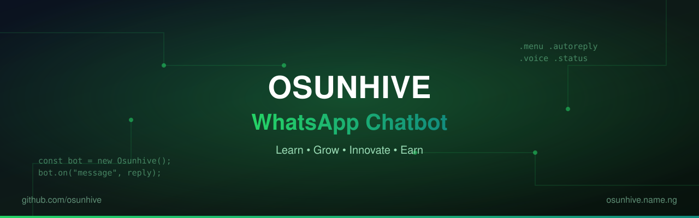

<div align="center">


[](https://www.osunhive.name.ng)

[](https://nodejs.org)
[](https://github.com/WhiskeySockets/Baileys)
[](https://github.com/Olajide2004/osunhive-whatsapp-chatbot/releases)
[](LICENSE)
[](https://github.com/Olajide2004/osunhive-whatsapp-chatbot/stargazers)
[](https://github.com/Olajide2004/osunhive-whatsapp-chatbot/network/members)
[](https://github.com/Olajide2004/osunhive-whatsapp-chatbot/issues)
[](https://github.com/Olajide2004/osunhive-whatsapp-chatbot/actions/workflows/ci.yml)



**An intelligent, production-ready WhatsApp automation bot — interactive list menus, Meta-AI style replies, automatic status posting, scheduling, voice notes, media tools and a full moderation suite.**

[**📖 Documentation**](USAGE.md) • [**🚀 Quick start**](#-quick-start) • [**📊 Statistics**](#-statistics) • [**🌐 Website**](https://www.osunhive.name.ng)

</div>

---

> [!WARNING]
> ⚠️ **Disclaimer — read before you run.**
> *Osunhive WhatsApp Chatbot* is an **independent, unofficial** project. It is **not affiliated with, endorsed by, or sponsored by** **WhatsApp LLC**, **Meta Platforms, Inc.** or the **Baileys** project.
> Automating a WhatsApp account **may violate WhatsApp's Terms of Service** and can get that number **banned**. Always use a **spare number**, and run it **at your own risk**.
>
> 🙏 **Acknowledgements & credit** — Built and maintained by **[Osunhive](https://www.osunhive.name.ng)** 🧠, powered by **[Baileys](https://github.com/WhiskeySockets/Baileys)** (the community WhatsApp Web API) 🧩, running on **WhatsApp** 💬. All product names, logos and brands are the property of their respective owners and are used for identification only.

---

## ✨ Features

| | Area | What it does |
| :-: | --- | --- |
| 🧭 | **Interactive menus** | `.menu` renders native WhatsApp list menus (single-select) with a **⬅️ Back to Menu** row in every section. |
| 🤖 | **Meta-AI replies** | **Bold** headline, `•` bullets, follow-up suggestions and a `— 🔷 Osunhive AI` signature, with progressive **"streaming"** edits that never split code blocks. |
| 🧠 | **Multi-engine AI** | `auto` → **ChatGPT Android** → **BJ-GPT** → **offline** rule-engine fallback (`.autoreply engine`). |
| 🛡️ | **Auto-reply controls** | The **owner is never auto-replied**; groups support `off / mention / all`, plus per-group cooldown and per-sender rate limiting. |
| 🎙️ | **Voice notes** | `.voice <text>` (**TTS → libopus PTT**) and `.autoreply voice on` to read the first sentence of each AI answer aloud. |
| 📢 | **Status posting** | `.autopoststatus on/off/now`, captions, rotation, background colour, font, recipients, delete, plus aliases. |
| ⏰ | **Scheduling** | `.schedule add ... every 30m | hourly | daily HH:MM` for **text, voice or status** messages. |
| 📊 | **Polls** | `.poll Question? | A | B`, multichoice, **live vote decryption**, results and delete. |
| 🔗 | **Link unfurling** | `.unfurl <url>` on demand and `.linkpreview on|off` for automatic **OpenGraph** preview cards. |
| 🧰 | **Moderation** | ban/unban, kick, promote/demote, mute, warn, antilink, antitag, antibot, antidelete, anticall, PM blocker, welcome/goodbye. |
| 🎁 | **Extras** | vCard, reactions, stickers, downloads, TTS, translation, weather, jokes/quotes and more. |

> **Full command reference:** [`USAGE.md`](USAGE.md) · **Internals & testing:** [`docs.md`](docs.md) · **Release notes:** [`CHANGELOG.md`](CHANGELOG.md)

---

## 🧩 Requirements

- **Node.js 18+**
- **ffmpeg** — voice notes, media conversion and stickers
- **Internet access** — WhatsApp Web + optional AI APIs
- A **WhatsApp account** for the bot (a spare number is recommended)

---

## 🚀 Quick start

```bash
# 1. Clone
git clone https://github.com/Olajide2004/osunhive-whatsapp-chatbot.git
cd osunhive-whatsapp-chatbot

# 2. Install dependencies
pnpm install      # or: npm install

# 3. Configure your number in settings.js
#    ownerNumber: '234XXXXXXXXXX'   <-- without "+"
#    commandMode: 'public' | 'private'

# 4. Run
node index.js
```

On first run, enter the **pairing code** shown in the terminal on the bot's phone
(**WhatsApp → Linked Devices → Link with phone number**), or scan the QR code.
Credentials are stored in `session/` — **never commit or share that folder.**

Set a custom pairing number without editing files:

```bash
BOT_PHONE_NUMBER=234XXXXXXXXXX node index.js
```

---

## ⚙️ Configuration

| Setting | Where | Notes |
| --- | --- | --- |
| `ownerNumber` | `settings.js` | **Bot owner** (no `+`). Owner-only commands and banner. |
| `commandMode` | `settings.js` | `public` = everyone, `private` = **owner/sudo only**. |
| `BOT_PHONE_NUMBER` | environment | Phone used for pairing; defaults to `ownerNumber`. |
| `session/` | runtime | **WhatsApp credentials — git-ignored.** |
| `data/*.json` | runtime | Feature state and defaults. Message/premium state is git-ignored. |

Most behaviour is toggled **from WhatsApp itself**, e.g.:

```text
.autoreply on
.autoreply group mention
.autoreply meta on
.autoreply voice on
.autopoststatus on
.linkpreview off
```

---

## 💬 Commands (quick sample)

```text
.menu                 interactive command list
.guide [full]         quick / full usage guide
.ping  .alive         health check
.voice <text>         voice note
.poll Question? | A | B
.schedule add here every 30m text Reminder
.autopoststatus on
.autoreply on
.ban  .kick  .mute  .warn
.fireworks Happy New Year
.countdown christmas|newyear|ramadan
```

> See [`USAGE.md`](USAGE.md) for the **complete list**, permissions and examples.

---

## 🎉 Celebrations

Light up a chat and keep an eye on the holidays:

| Command | What it does |
| --- | --- |
| `.fireworks [text]` | Sends an **animated 🎆 fireworks message** that cycles through several frames, with your own greeting. |
| `.countdown` | Shows the **live countdown** to 🎄 Christmas, 🎆 New Year and 🌙 Ramadan (fasting). |
| `.countdown christmas` | Full detail for one occasion (`.countdown newyear` / `.countdown ramadan`). |

```text
🎆✨ *FIREWORKS!* ✨🎆
　✨　　　🎆　　　✨
🎇　　　💥　　　🎇
　✨　　　🎆　　　✨

🎉 *Osunhive Countdown*
🎄 Christmas — 44 days · 25 Dec 2026
🎆 New Year — 51 days · 01 Jan 2027
🌙 Ramadan (fasting) — 99 days · 18 Feb 2027
```

> 🌙 Ramadan dates follow moon sighting and can shift by a day.

---

## ☁️ Deploy (VPS)

Source-only package — install dependencies on the server.

```bash
unzip osunhive-v2-2.0.0-release.zip -d /opt/osunhive-v2
cd /opt/osunhive-v2
pnpm install
node index.js
```

A systemd unit and PM2 config are provided in [`deploy/`](deploy/):

- `deploy/osunhive-bot.service`
- `deploy/ecosystem.config.js`
- `deploy/start.sh` / `deploy/stop.sh`
- `deploy/README.md` — **step-by-step VPS guide**

> Use **`SIGTERM`** to stop (never `kill -9`) so the session is flushed cleanly.

---

## 🗂️ Project layout

```text
index.js            connection, pairing, startup banner
main.js             message routing and command dispatch
settings.js         owner, mode, version
commands/           one file per command
lib/                shared helpers (AI layout, previews, TTS, store, auth)
data/               JSON state/defaults (runtime state git-ignored)
deploy/             systemd / PM2 / scripts
.github/workflows/  automation (contribution snake)
test-*.js           offline test suites
```

---

## 🧪 Tests

**Offline suites** — no WhatsApp connection needed:

```bash
node test-meta-style.js
node test-autoreply-format.js
node test-autopoststatus.js
node test-scheduler.js
node test-polls.js
```

---

<h2 align="center">📊 Statistics</h2>

<div align="center">


</div>

### 📌 Project facts

| Metric | Value |
| --- | :---: |
| **Version** | `2.0.0` |
| **Engine** | Baileys `7.0.0-rc.9` (Node ≥ 18) |
| **Command modules** | `116` |
| **Library modules** | `36` |
| **Menu sections** | `12` |
| **Source lines** | `~22,800` |
| **Test suites** | `6` offline suites |
| **Release archive** | ~1.7 MB (source only) |

---

## 🔐 Security & limitations

- **Never commit `session/` or `baileys_store.json`** — they contain **WhatsApp keys**.
- `data/messageCount.json` and `data/premium.json` are **runtime state** and git-ignored.
- Some fun/AI helpers ship with **third-party free-tier API keys** inherited from the original scaffold — **replace them with your own keys** for production.
- Quick-reply *buttons* are unreliable on some WhatsApp clients; navigation uses **native list menus** instead.
- Automating a WhatsApp account may violate **WhatsApp's Terms of Service** — use a spare number and at your own risk.

---

<h2 align="center">🌐 Connect with Osunhive</h2>

<div align="center">

[](https://www.osunhive.name.ng)
[](https://yo.fan/osunhivetech)
[](https://www.youtube.com/channel/UCh0GXMxUUshupWAPvYkvPEA)

[](https://www.facebook.com/osunhive.name.ng)
[](https://twitter.com/Sherifhive)
[](https://www.linkedin.com/in/osunhiveofficial/)

[](http://t.me/Osunhive)
[](https://www.tiktok.com/osunhive.name.ng)

</div>

---

## 💚 Credits

- 💬 **[WhatsApp](https://www.whatsapp.com)** (Meta Platforms, Inc.) — the platform this bot automates. **Unofficial; not affiliated with or endorsed by WhatsApp/Meta.**
- 🧩 **[Baileys](https://github.com/WhiskeySockets/Baileys)** by **WhiskeySockets** — the community WhatsApp Web API this bot is built on.
- 🧠 **[Osunhive](https://www.osunhive.name.ng)** — created, maintained and funded by Osunhive Technology · business GitHub: [**@osunhive**](https://github.com/osunhive)
- 🎓 **Free coding at [www.osunhive.name.ng](https://www.osunhive.name.ng)** · 🔗 all links: [**yo.fan/osunhivetech**](https://yo.fan/osunhivetech)
- 🙏 Original bot scaffold and community libraries whose authors made this possible.
- ⚖️ All trademarks, logos and brand names are the property of their respective owners and are used for **identification only**.

---

## 📄 License

[**MIT**](LICENSE) © **Osunhive**

<div align="center">


**[⬆ back to top](#osunhive-whatsapp-chatbot)** · Made with 💚 by [**Osunhive**](https://www.osunhive.name.ng)

</div>
